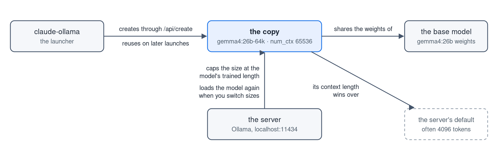

# claude-ollama

Claude Code runs against a local Ollama server once you point its base URL there
and name a model. But Claude Code speaks the Anthropic API, which carries no
context length, so Ollama serves each request at the server's default, often 4096
tokens. Claude Code's system prompt and tool list alone pass that size, so the
server trims the prompt and the model answers from a cut conversation.

**claude-ollama starts Claude Code on a copy of your model with the context length
built in**, and sets every variable Claude Code needs to stay on Ollama.

## Launch Claude Code

claude-ollama copies the model once with its context length set, then starts
`claude` on the copy:

```console
$ claude-ollama -p "reply with OK"
creating gemma4:26b-64k from gemma4:26b with num_ctx 65536
claude -> http://localhost:11434 (gemma4:26b-64k, 65536 tokens)
[claude-code:unrecognized_model] {"model":"gemma4:26b-64k","query_source":"sdk"}
OK
```

It needs `claude`, `curl` and `jq`, and an Ollama server that holds the model.
From the repo, link the script into `~/bin` and create your config:

```bash
make install config
```

`make` lists every target: `install`, `uninstall`, `config` and `check`.

A first argument that starts with a letter or digit names the model, and the rest
go to `claude`:

```bash
claude-ollama                                  # the model and size in your config
claude-ollama qwen3.8:27b                      # another model
claude-ollama --context-length 32k -p "hi"     # another size, one question
```

claude-ollama stops with a message in four cases:

- A setting is missing from the command line, the environment and the config file.
- The server is unreachable.
- The model is missing.
- The model lacks tool support. Claude Code sends tool definitions on every
  request, and Ollama refuses them for such a model, so the message lists the
  server's models that support tools.

## Settings

Each setting comes from the command line, the environment or the config file; the
command line wins over the environment, and the environment over the config file.
claude-ollama has no built-in defaults: it names each setting none of them gives,
and stops.

| Setting | Command line | Environment | Config file | In `config.example.conf` |
|---|---|---|---|---|
| Server URL | — | `CLAUDE_OLLAMA_URL` | `url` | `http://localhost:11434` |
| Model | first argument | `CLAUDE_OLLAMA_MODEL` | `model` | `gemma4:26b` |
| Context length | `--context-length` | `CLAUDE_OLLAMA_CONTEXT_LENGTH` | `context_length` | `64k` |

The config file lives at `~/.config/claude-ollama/config`, or at
`$XDG_CONFIG_HOME/claude-ollama/config` when you set `XDG_CONFIG_HOME`. `make config`
creates it from `config.example.conf`, and leaves an existing file alone.

The script parses the file as `key=value` lines, where `#` starts a comment, and
treats every value as text. It stops at an unknown key or a malformed line and
names the line number.

## Context length

A model's own context length wins over the server's default, so the copy carries
its size to any server. The size names the copy: `gemma4:26b-64k` for `64k`
(65536 tokens), and `<model>-ctx50000` for a count like 50000, which falls between
multiples of 1024. claude-ollama creates the copy through the server's
`/api/create` and reuses it on later launches. The copy shares the base model's
weights, so it costs only a few kilobytes of disk.



- When you switch sizes, **the server loads the model again**. Pick one size in
  the config file.
- The server caps the size at the model's trained length.
- The copy keeps the weights it started from. After you pull a newer base model,
  run `ollama rm gemma4:26b-64k`, and the next launch builds the copy again.

## What it sets for Claude Code

Claude Code also reaches for Anthropic: its settings can name another provider,
its subagents ask for Claude model names, and some features call Anthropic's
servers. Each of these requests fails against Ollama. And for a model ID it
doesn't recognize, Claude Code assumes a window of 1M tokens and compacts to fit
it. Before it starts `claude`, claude-ollama sets the variables that upstream
Ollama's `ollama launch claude` sets, plus the window:

| Variables | Effect |
|---|---|
| `ANTHROPIC_BASE_URL`, `ANTHROPIC_AUTH_TOKEN=ollama`, `ANTHROPIC_API_KEY` set empty | Send every request to the server. An API key in the environment would win over the URL. |
| `ANTHROPIC_MODEL`, `ANTHROPIC_DEFAULT_OPUS_MODEL`, `ANTHROPIC_DEFAULT_SONNET_MODEL`, `ANTHROPIC_DEFAULT_HAIKU_MODEL`, `CLAUDE_CODE_SUBAGENT_MODEL` | Run every model tier and every subagent on the copy. |
| `CLAUDE_CODE_MAX_CONTEXT_TOKENS`, the copy's context length | Size Claude Code's window, and the compaction that fits it, to the copy. |
| `CLAUDE_CODE_PROVIDER_MANAGED_BY_HOST=1`, each `CLAUDE_CODE_USE_*` set empty | Keep the session on Ollama when Claude Code settings name another provider. |
| `ENABLE_CLAUDEAI_MCP_SERVERS=false`, `CLAUDE_CODE_ATTRIBUTION_HEADER=0`, `CLAUDE_CODE_TOTAL_TOKENS_REMINDER=off`, `DISABLE_ERROR_REPORTING=1`, `DISABLE_FEEDBACK_COMMAND=1`, `CLAUDE_CODE_DISABLE_FEEDBACK_SURVEY=1`, `DISABLE_AUTOUPDATER=1` | Turn off what needs Anthropic's servers. |
| `CLAUDE_CODE_AUTO_MODE_SERVER=0`, unless already set | Use Claude Code's own auto-mode classifier: Ollama lacks the server-side check. |

Last tested: Claude Code 2.1.332 against ollama37 2.3.4, a fork of Ollama for the
Tesla K80.
